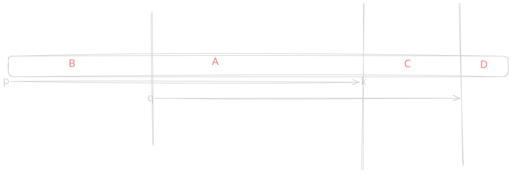

赛时排名 325 说是（）时间分配还行，40min 切 D，20min 切 E，然后最后把 F 做了，perf 1952。

AB 是签到题，跳过。

## [C - Second Choice Election](https://atcoder.jp/contests/abc483/tasks/abc483_c)

**题意：** 有 $m$ 张选票给 $n$ 个人投票，每个选票上选了一个主要和一个非主要目标。如果主要目标没有退出，那么就投给主要目标，否则投给非主要目标。求每一个人分别退出后的得选者（平票选择序号小的）。

比较神奇的复杂度计算。

先维护每个人作为主要目标时的非主要目标有哪些，同时统计票数最高的前两名。遍历退出的人，初始化得选者是原本票数最高的人。之后每次有人退出就遍历其为主要目标的非主要目标，并给他们计票。特别地，如果退出的人是票数最高的人，那么初始化得选者是票数第二高的人。

于是每个人平均被退出一次，增加一次选票，撤回一次选票，复杂度 $O(n)$。

```cpp
void solve() {
    int n, m, w1 = 0, w2 = 0;
    fr(n, m);
    vector<int> a(m + 1), b(m + 1), cnt(n + 1);
    vector<vector<int>> ab(n + 1);
    for (int i = 1; i <= m; ++i) fr(a[i], b[i]), ++cnt[a[i]];
    for (int i = 1; i <= m; ++i) ab[a[i]].emplace_back(b[i]);
    for (int i = n; i >= 1; --i) {
        if (cnt[i] >= cnt[w1]) w2 = w1, w1 = i;
        else if (cnt[i] >= cnt[w2]) w2 = i;
    }
    for (int i = 1; i <= n; ++i) {
        int p = w1;
        if (i == w1) p = w2;
        for (int v : ab[i])
            if (++cnt[v] > cnt[p] || (cnt[v] == cnt[p] && v < p)) p = v;
        for (int v : ab[i]) --cnt[v];
        fwn(p);
    }
}
```

## [D - Glitchy Robot](https://atcoder.jp/contests/abc483/tasks/abc483_d)

**题意：** 给定一个长度为 $n$ 的数列 $a_i$，你可以选择不超过一个数将其变为其相反数。求操作后的前缀和最大值和前缀和最小值的差值的最大值（题意还要加一）。

我们发现将一个数变为相反数使之后的所有前缀和减小 $2a_i$，于是相当于后缀的前缀和最大值最小值都减少 $2a_i$，这时有可能小于前缀的了，所以需要比较。

于是我们只需要先计算前缀和，然后算出前缀、后缀的最大值、最小值即可。

```cpp
void solve() {
    int n;
    fr(n);
    vector<ll> a(n + 1), smx(n + 1), smn(n + 1), pmx(n + 1), pmn(n + 1);
    frn(a, n);
    for (int i = 1; i <= n; ++i)
        pmx[i] = pmn[i] = smn[i] = smx[i] = smx[i - 1] + a[i];
    for (int i = n; i >= 1; --i) {
        smx[i - 1] = max(smx[i - 1], smx[i]);
        smn[i - 1] = min(smn[i - 1], smn[i]);
    }
    for (int i = 1; i <= n; ++i) {
        pmx[i] = max(pmx[i - 1], pmx[i]);
        pmn[i] = min(pmn[i - 1], pmn[i]);
    }
    ll ans = smx[0] - smn[0] + 1;
    for (int i = 1; i <= n; ++i) {
        ans = max(ans,
            max(pmx[i - 1], smx[i] - 2 * a[i])
                - min(pmn[i - 1], smn[i] - 2 * a[i]) + 1);
    }
    fwn(ans);
}
```

## [E - Typo Pairs](https://atcoder.jp/contests/abc483/tasks/abc483_e)

**题意：** 给定 $n$ 个长度为 $m\le 6$ 的小写字母串，求汉明距离（即对应位置不同的个数）不超过 $2$ 的字符串对数。

神奇的暴力计数+优化。

距离为 0 是易求的，直接开个桶暴力统计即可（记作 $c_0$）。

距离为 1 也不难，直接枚举每个位置，再枚举每个位置被修改为其他字母，然后再统计即可（记作 $c_1$）。

距离为 2 不能直接暴力，可以枚举两个位置将其删掉再放进桶里统计，发现这样会把前面的两种算重，确切地说，这里的值是：
$$
\binom m2c_0+(m-1)c_1+c_2
$$

直接减去就行。

```cpp
void solve() {
    int n, m;
    fr(n, m);
    vector<string> s(n + 1);
    frn(s, n);
    unordered_map<string, ll> cnt;
    for (int i = 1; i <= n; ++i) ++cnt[s[i]];
    ll ans = 0;
    for (auto [x, c] : cnt) ans -= (c * (c - 1) >> 1) * (m * (m - 1) / 2 - 1);
    for (int i = 0; i < m; ++i) {
        for (char c = 'a'; c <= 'z'; ++c) {
            for (int j = 1; j <= n; ++j) {
                if (s[j][i] == c) continue;
                auto st = s[j];
                st[i] = c;
                if (st < s[j] && cnt.count(st)) ans += (cnt[st] * (2 - m));
            }
        }
    }
    for (int i = 0; i < m; ++i) {
        for (int j = i + 1; j < m; ++j) {
            unordered_map<string, ll> c;
            for (int k = 1; k <= n; ++k) {
                string st;
                for (int x = 0; x < i; ++x) st += s[k][x];
                for (int x = i + 1; x < j; ++x) st += s[k][x];
                for (int x = j + 1; x < m; ++x) st += s[k][x];
                ++c[st];
            }
            for (auto [x, v] : c) ans += v * (v - 1) / 2;
        }
    }
    fwn(ans);
}
```

## [F - Sum of Mod of Linear](https://atcoder.jp/contests/abc483/tasks/abc483_f)

**题意：** 给两个长度为 $n$ 的数列 $a_i,b_i$，进行 $q$ 组询问，每组询问给一个整数 $x$，求 $\sum_{i=1}^n((a_i+x)\mod b_i)$。

根号分治！我们发现这个答案与 $b$ 的范围息息相关，并且可以根据 $b$ 的范围简化。

如果 b 较小，我们可以直接求出给定模 b 的余数的和，设其为 $g(b,x)$，于是有：
$$
\begin{aligned}
g(b,x)&=\sum_{b_i=b}((x+a_i)\mod b) \\
      &=\sum_{b_i=b}(x+a_i-b[x+a_i\ge b]) \\
      &=\sum_{b_i=b}a_i+x|b较小|-b\sum_{i\ge b-x}f(b,i) \\
      &=s_b+x\cdot cnt_b-b\cdot suf_{b-x}
\end{aligned}
$$

这样就求出了模数较小的情况。然后考虑模数较大，这是不能直接枚举余数了，但由于模数较大，需要较大值变化才会产生一次取模，于是可以枚举产生取模的地方。第一次发生取模的位置在 $b_i-a_i$，此后每隔 $b_i$ 产生一次取模，即答案减去 $b_i$。这个可以差分维护。
$$
\begin{aligned}
(x+a_i)\mod b_i&=x+a_i-b_i\lfloor\frac{x+a_i}{b_i}\rfloor \\
\sum((x+a_i)\mod b_i)&=\sum a_i+|b_i较大|x-\sum b_i\lfloor\frac{x+a_i}{b_i}\rfloor \\
&=\sum a_i+|b_i较大|x-\sum d_i, \\
d_{kb_i-a_i}&=\sum b_i
\end{aligned}
$$

然后直接统计答案即可。此处取分界点大致为 $\sqrt{\frac{NX}Q}\approx 1024$ 即可，复杂度约根号量级。

```cpp
const int B = 1024;
ll f[B][B], g[B][B], cnt[B], s[B], bs;
void solve() {
    int n, q, xm;
    fr(n);
    vector<pair<int, int>> v(n), bb;
    fr(v), fr(q);
    vector<int> sb, qry(q);
    fr(qry), xm = *ranges::max_element(qry);
    for (auto [a, b] : v) {
        if (b < B) {
            if (!cnt[b]) sb.emplace_back(b);
            ++cnt[b], ++f[b][a], s[b] += a;
        } else {
            bb.emplace_back(a, b), bs += a;
        }
    }
    for (ll b : sb) {
        vector<ll> suf(b + 1);
        for (int i = b - 1; i >= 0; --i) suf[i] = suf[i + 1] + f[b][i];
        for (int i = 0; i < b; ++i)
            g[b][i] = s[b] + cnt[b] * i - b * suf[b - i];
    }
    vector<ll> d(xm + 1), bans(xm + 1);
    for (auto [a, b] : bb)
        for (int t = b - a; t <= xm; t += b) d[t] += b;
    for (ll x = 0, pre = 0; x <= xm; ++x)
        bans[x] = bs + x * bb.size() - (pre += d[x]);
    for (int x : qry) {
        ll ans = bans[x];
        for (int b : sb) ans += g[b][x % b];
        fwn(ans);
    }
}
```

## [G - Qualification](https://atcoder.jp/contests/abc483/tasks/abc483_g)

**题意：** 给定正整数 $n,k$，求所有的两个长度为 $n$ 的排列 $p_i,q_i$ 满足 $p_i$ 前 $k$ 小的与 $q_i$ 剩余的前 $k$ 小的集合中包含而反过来（先取 $q_i$ 前 $k$ 小）的集合中不包含的元素个数之和。

计数转期望，期望转计数。

先给 $p_i$ 定序为从小到大，然后只需要考虑等概率随机的 $q_i$，并求出共有元素长度的期望，再乘上 $n!$。

于是我们将这个长为 $n$ 的序列分为 $4$ 段，分别为 $p_i\le k,q_i\le k$ 等，设第一类长度为 $m$。于是两种取法都只有最后长度为 $n+m-2k$ 一类（$p_i>k,q_i>k$）能贡献答案。

于是问题相当于求这个长度为 $n+m-2k$ 的排列（重新规定大小，相当于离散化）中选两个长度为 $m$ 的序列，求 $E[|D_1 \setminus D_2|]$。然后有：
$$
\begin{aligned}
E[|D_1\setminus D_2|]&=m-E[|D_1\cap D_2|] \\
E[|D_1\cap D_2|]&=\sum_{x=1}^{n+m-2k} P(x\in D_1\wedge x\in D_2) \\
 &=(n+m-2k)\cdot(\frac m{n+m-2k})^2 \\
 &=\frac{m^2}{n+m-2k}
\end{aligned}
$$

再考虑第一类长度为 $m$ 的概率，如图：


这里为了方便画图，就假定 $q$ 中不超过 $k$ 的是连续的，然后给 $q$ 赋值：A 段相当于在前 $k$ 个位置中选 $m$ 个给 $q$ 填，于是 $\binom km$。C 段相当于在剩下的 $n-k$ 个位置中选 $k-m$ 个填入，于是 $\binom{n-k}{k-m}$。最后给 $q$ 的前 $k$ 个任意顺序赋值，以及 $n-k$ 个任意顺序，也就是 $n!(n-k)!$。

于是最终答案为：
$$
ans=n!k!(n-k)!\sum_{m=1}^k\binom{k}{m}\binom{n-k}{k-m}(m-\frac{m^2}{n+m-2k}) 
$$

```cpp
const int N = 1e6 + 5, mod = 998244353;
ll fac[N], invf[N];
inline ll bfp(ll a, ll b = mod - 2) {
    ll ans = 1;
    for (a %= mod; b; b >>= 1, a = a * a % mod)
        if (b & 1) ans = ans * a % mod;
    return ans;
}
inline ll C(int n, int m) {
    if (n < 0 || m < 0 || n < m) return 0;
    return (lll)fac[n] * invf[n - m] % mod * invf[m] % mod;
}
void init() {
    fac[0] = 1;
    for (int i = 1; i < N; ++i) fac[i] = fac[i - 1] * i % mod;
    invf[N - 1] = bfp(fac[N - 1]);
    for (int i = N - 1; i; --i) invf[i - 1] = invf[i] * i % mod;
}
void solve() {
    ll n, k;
    fr(n, k);
    lll ans = 0;
    for (ll m = 1; m <= k; ++m)
        ans = (ans
                  + C(k, m) * C(n - k, k - m) % mod
                      * ((n * m - 2 * m * k) % mod + mod) % mod
                      * bfp(n + m - k * 2) % mod)
            % mod;
    fwn(ans * fac[n] % mod * fac[k] % mod * fac[n - k] % mod);
}
```