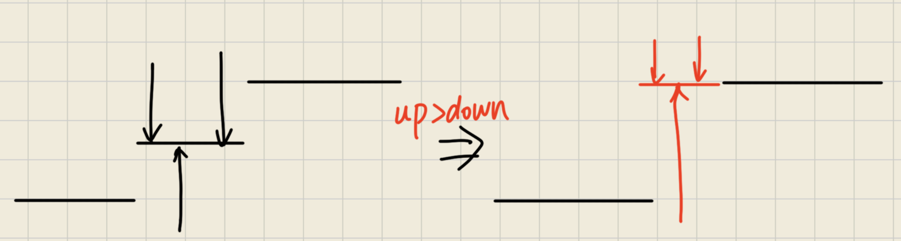

国庆期间的娱乐赛，十道题的难度跨度很大 —— 从签到题到卡快排、4MB 内存分块都有。

## G T826175 若人生只如初见 (P2501)

**题意：** 给定正整数序列 $a_i$ ，修改几个数使之严格递增。求最少修改数的个数以及在此前提下的最小修改幅度。

首先考虑第一问，考虑最终情况，加入保留了两个数 $a_i$ $a_j$ ，则有 $a_j-a_i \ge j-i (j > i)$ ，移项得到 $a_j - j \ge a_i - i$ ，令 $b_i=a_i-i$ 则需修改的最少个数应为 $n-\operatorname{LNDS}(b_i)$ 其中 $\operatorname{LNDS}$ 为最长不下降子序列。

然后考虑修改幅度，我们发现修改 $a_i$ 幅度最小当仅修改 $b_i$ 幅度最小，而对于任意保留的 $b_i$ $b_j$ ，我们发现其中任意一个元素调整到 $b_i$ 或者 $b_j$ 总不会变得更差（归纳法容易证明，如果一段内大于的多于小于的，直接调大到边界总是更优，反之同理），则段内必存在一个分界点 $k$ 使得其左右分别取两个端点的值时调整幅度最小。如图：



尝试暴力 DP，在计算 LNDS 时记录当前该位置如果被选时的最长长度 $f(i)$ 再维护 $g(i)$ 为当前位置被选时的最小调整代价，则有：

$$
g(i)=\min_{f(j)=f(i)-1,j<i}g(j)+\min_{k=j+1}^{i-1}(\sum_{l\le k}|a_k-a_j|+\sum_{l>k} |a_l-a_i|)
$$


直接暴力 DP 就行，该题数据随机，足以通过本题。

```cpp
int n;
fr(n);
vector<ll> a(n + 1), b(n + 2);
frn(a, n);
for (auto [i, x] : a | views::enumerate) b[i] = x - i;
b[0] = -1e12, b[n + 1] = 1e12;
vector<ll> f(n + 2), lnds { b[0] };
vector<vector<int>> gr(n + 2);
for (int i = 1; i <= n + 1; ++i) {
    int p = ranges::upper_bound(lnds, b[i]) - lnds.begin();
    if (p >= lnds.size()) lnds.emplace_back(b[i]);
    else lnds[p] = b[i];
    gr[p].emplace_back(i), f[i] = p;
}
fwn((ll)n - lnds.size() + 2), gr[0].emplace_back(0);
vector<ll> g(n + 2, LLONG_MAX);
g[0] = 0;
for (int i = 1; i <= n + 1; ++i) {
    for (int j : gr[f[i] - 1]) {
        if (j > i) break;
        if (b[j] > b[i]) continue;
        ll cur = 0, mn = 0;
        for (int k = j + 1; k < i; ++k) mn = (cur += abs(b[k] - b[i]));
        for (int k = j + 1; k < i; ++k) {
            cur += abs(b[k] - b[j]) - abs(b[k] - b[i]);
            mn = min(mn, cur);
        }
        g[i] = min(g[j] + mn, g[i]);
    }
}
fwn(g[n + 1]);
```

## H T826176 类格雷码（改自神秘 gym 题）

**题意：** 求 $m$ 阶格雷码并要求相邻异或值的积最小，在此前提下字典序最小。

观察样例不难发现前 $2^{\log m}2^{\left \lfloor \log m \right \rfloor }$ 个数恰好是一段完整的格雷码，之后的部分也构成一段格雷码，则目标转化为求一个最小的开始值使得前后两端能够正常衔接。

观察格雷码的性质，不难发现前半段中首尾异或值恰好为次高位（ $2^{L-1}$ ），两段衔接处异或值恰好为最高位（ $2^L$ ）则考虑分治，每次将目标区域分为前半段完整的格雷码和后半段偏移后的格雷码，而 $0$ 开头的格雷码求法是熟知的：`m ^ (m >> 1)` 只需异或初始值就能得到新的格雷码。依次分治即可，代码如下：

```cpp
int n;
fr(n);
if (n == 1) return fwn(0);
if (n == 2) return fwn(0, 1);
auto gray = [](int m) { return m ^ (m >> 1); };
vector<int> ans;
ans.reserve(n);
auto getx = [](this auto&& self, int m, int t) -> pair<int, int> {
    if (m == 1) return { t, 0 };
    if (m == 2) return t <= (t ^ 1) ? pair { t, 0 } : pair { t ^ 1, 1 };
    int mx = 1 << __lg(m - 1), m2 = m - mx;
    auto [v1, y1] = self(m2, t ^ (mx >> 1));
    auto [v2, y2] = self(m2, t ^ mx);
    return v1 < v2 ? pair { v1, y1 ^ (mx >> 1) } : pair { v2, y2 ^ mx };
};
auto calcg = [&](int mx, int s, int o) {
    for (int i = 0; i < mx; ++i) ans.emplace_back((gray(i) ^ s) + o);
};
auto calcl = [&](this auto&& self, int m, int x, int o) -> void {
    if (m == 1) return ans.emplace_back(o), void();
    if (m == 2) {
        ans.emplace_back(o + x), ans.emplace_back(o + (x ^ 1));
        return;
    }
    int mx = 1 << __lg(m - 1), m2 = m - mx;
    if (x & mx)
        self(m2, x ^ mx, o + mx), calcg(mx, x ^ mx ^ gray(m2 - 1), o);
    else calcg(mx, x, o), self(m2, x ^ (mx >> 1), o + mx);
};
int mx = 1 << __lg(n - 1), n2 = n - mx;
int x = getx(n2, mx >> 1).second, s = x ^ (mx >> 1);
calcg(mx, s, 0), calcl(n2, x, mx), fwn(ans);
```

## I T826178 6 连通块

**题意：** 求摆放方式使得每一种 6-连通块能够放入 $19\times19$ 网格且空出中心格。

没什么好说的，直接写个爆搜就行，这里给出我当时的答案：

```text
8333992291119999922
8833395299115555926
8000095229914452226
8858095233944451366
1558095553334711336
1158887777377771136
1758222772222701033
1752232444992205000
1777433484499005002
007443388.990055522
8044993688844452226
8049998666605444666
8009788880605555166
8877789110005411118
6876799911122443318
6666993364124433888
5555553664221433877
6667733364421110007
6667777664411000777
```

## J T826179 Anti-Quicksort

**题意：** 卡快排。
重点关注最后一个，能卡掉最后一个就能全部卡掉。

首先发现该方法是常见的选择左右和中间三个数的中位数作为标记，那么我们目标就是让这三个数分别是最大、最小和次大（次小），从而每一次快排只能使问题规模缩小 $2$ 从而卡到 $n^2$

考虑模拟这一过程，将最大值设为一个标记（因为你不知道要多大），然后按照该操作进行就行，最后根据标记的顺序从大到小给数列赋值，此时构造出来的序列每次快排取的标兵值都是次大或次小值，而选中间或者两边的也能被卡掉。而方法 5 中新增的小规模数据时插入排序只能降低常数，当我们将标兵值选为次大（次小）值时这一次插排需要交换 $n$ 次，无法加速，最终比较次数达到 $O(\frac{n^2}4)$。

```cpp
int n = 1e5;
vector<int> flag(n), vis, ans(n, 1);
ranges::iota(flag, 0);
for (auto [i, x] : flag | views::enumerate | views::reverse) {
    vis.emplace_back(flag[i >> 1]), swap(x, flag[i >> 1]);
}
for (auto x : vis) ans[x] = n--;
fwn(ans.size()), fwn(ans);
```
当然该方法取巧的地方在于每一次认为取到的值在中间，然后将其加入 `vis` 中等候赋值，然后按照题目要求将标兵值交换到最右边。

## K T826180 古希腊掌管均衡的神 （CF 2260E）

**题意：** 给定一个 $0/1$ 字符串，求插入最少的 $0/1$ 使得 $00$、$01$、$10$、$11$ 个数相等，首尾元素也算相邻。
观察发现任意插入，$01$ $10$ 个数相等且不降，考虑设最终 $01$ 个数为 $x$，则结果为 $4x-len$。而分类讨论插入位置后显然有

$$
x \ge b+\max(0,a-x)+\max(0,d-x)
$$
其中 $a$ 为 $00$ 个数，$b$ 为 $01$ 个数，其他同理。分讨 $a,d,x$ 大小关系将 $x$ 移到同一侧即可。

```cpp
int n, q;
string s;
string s;
fr(n, q), fr(s), s = ' ' + s;
auto calc = [](char x, char y) { return (x ^ 48) << 1 | (y ^ 48); };
vector<array<int, 4>> cnt(n + 1);
for (int i = 2; i <= n; ++i) {
    cnt[i] = cnt[i - 1], ++cnt[i][calc(s[i - 1], s[i])];
}
while (q--) {
    int l, r, a, b, c, d;
    fr(l, r), ++cnt[r][calc(s[r], s[l])];
    a = cnt[r][0] - cnt[l][0], b = cnt[r][1] - cnt[l][1];
    c = cnt[r][2] - cnt[l][2], d = cnt[r][3] - cnt[l][3];
    --cnt[r][calc(s[r], s[l])];
    if (l == r) {
        fwn(3);
        continue;
    }
    if (a == b && b == c && c == d) {
        fwn(0);
        continue;
    }
    int x = max({ a, b, c, d });
    if (max(a, (b + d + 1) >> 1) < d) x = min(x, max(a, (b + d + 1) >> 1));
    if (max(d, (a + b + 1) >> 1) < a) x = min(x, max(d, (a + b + 1) >> 1));
    if ((a + b + d + 2) / 3 < min(a, d)) x = min(x, (a + b + d + 2) / 3);
    fwn((x << 2) - (r - l+ 1));
```

注意特判不需要调整和长度为 $1$ 的情况。

## L T826182 新三体问题

**题意：** 求不超过 $n$ 的互不相等的数对个数，满足： $a+c=2b,a \oplus b = c$

考虑一些异或性质（ $a\oplus b = a+b-2(a \& b)$ ）并代入化简：

$$
a+c=2(a+c-2(a\&c))
$$

$$
a+c=4(a\&c)=4s
$$

令 $c=s+u, a=s+v$ 显然都没有重复位，加法相当于按位或，而带入又有 $u+v=2s$ ，则 $u$ 与 $v$ 与 $s$ 没有相同位，而 $u+v=2s$ 也与 $s$ 没有相同位。

也就是说 $u$ 和 $v$ 的每一位来自 $2s$，且 $s$ 没有连续的 $1$ （否则 $s \& (2s) > 0$ ）。当仅 $2s$ 的首位给 $u$ 时能保证 $u>v,c>a$ ，且此时 $a<b<c$ 。

可以从高位到低位进行数位 DP。我的代码采用记忆化搜索的写法：

```cpp
inline ll dfs(int k, bool s, bool t, bool p) {
    if (k < 0) return !(!s || (t && (p > (n & 1))));
    if (vis[k + 1][s][t][p]) return f[k + 1][s][t][p];
    vis[k + 1][s][t][p] = 1;
    ll cur = 0;
    for (int sk = 0; sk < 2; ++sk) {
        if (sk && p) continue;
        for (int uk = 0; uk <= sk; ++uk) {
            if (!s && sk && !uk) continue;
            int ck = p | uk, nt = t;
            if (t && ck < ((n >> (k + 1)) & 1)) nt = 0;
            else if (t && ck > ((n >> (k + 1)) & 1)) continue;
            cur = (cur + dfs(k - 1, s | sk, nt, sk)) % mod;
        }
    }
    return f[k + 1][s][t][p] = cur % mod;
}
```

最终结果就是 `dfs(62, 0, 1, 0)` 记得清空 `vis` 数组。

## R T826189 Contrasty Angeles [Easy Lv.1]

**题意：** 求数列某段异或给定值的最大值。

可持久化字典树模板题！

考虑维护一个可持久化 01Trie，版本 $i$ 表示下标 $1$ 到 $i$ 的值的个数（对于 01Trie，这一个数还包含了每一位的 $0/1$ 情况），每次查询时优先查看与询问的 $k$ 相反的位就行。

```cpp
vector<int> a(n + 1), rt(n + 1), cnt { 0 };
vector<array<int, 2>> tr(1);
frn(a, n), fr(q);
cnt.reserve(n << 5 | 1), tr.reserve(n << 5 | 1);
auto insert = [&](this auto&& self, int p, int x, int b = 30) -> int {
    int u = tr.size();
    tr.emplace_back(tr[p]), cnt.emplace_back(cnt[p] + 1);
    if (b < 0) return u;
    return tr[u][(x >> b) & 1] = self(tr[p][(x >> b) & 1], x, b - 1), u;
};
auto query = [&](this auto&& self, int u, int v, int k, int b = 30) -> int {
    if (b < 0) return 0;
    int f = ((k >> b) & 1) ^ 1;
    if (cnt[tr[u][f]] > cnt[tr[v][f]])
        return self(tr[u][f], tr[v][f], k, b - 1) + (1 << b);
    return self(tr[u][f ^ 1], tr[v][f ^ 1], k, b - 1);
};
```

## T T826161 测测你的工科高等代数

**题意：** 对于给定数（最大 $\pm 2^{75}$），构造整数行列式等于该值，要求行列式中每个数绝对值不大于 $16$ 且阶数不大于 $16$

个人感觉最逆天题（除了不会写的 BA）。

考虑构造矩阵：

$$
A_n=
\begin{bmatrix}
  15& -16&   0& \cdots& 0& a_1 \\
  16&  15& -16& \cdots& 0& a_2 \\
  \vdots& \vdots& \vdots& \ddots & \vdots& \vdots \\
  16&  16&  16& \cdots& -16& a_{n-2} \\
  16&  16&  16& \cdots& 15& a_{n-1}\\
  16&  16&  16& \cdots& 16& a_n
\end{bmatrix}
$$

简单消元（ $R_i\leftarrow R_i-R_{i-1}$ ）后考虑递推可得：（ $D_n$ 为去掉最后一行一列的余子式）

$$
D_n=31D_{n-1}+16D_{n-2}
$$

此时最后一列变为： $b_i=a_i-a_{i-1}(a_0=0)$

考虑消元后的矩阵沿最后一列展开，则余子式： $M_i=D_{i-1}$ （显然的，可以画出来自己看看，只有左上角有效，右下角对角线全为 $1$ ）也就是：

$$
\det A=\sum(-1)^iD_{i-1}(a_i-a_{i-1})
$$

再令

$$
u_i = (-1)^i a_i, E_i = \frac{D_i+D_{i+1}}{16}
$$

得到：

$$
\det A=16\sum_{i=0}^{14}E_iu_{i+1}+D_{15}u_{16}
$$

由于相邻的 $E_i$ 比值略小于 $32$ ，可将其类似理解为 $32$ 进制，可以贪心的给 $u_i$ 取值，即满足：

$$
|Q-u_{i+1}E_i|\le16S_{i-1}
$$

的最小值，其中 $Q$ 为当前剩余可以安排的值， $S$ 为 $E$ 前缀和。以下为代码：

```cpp
lll d[17], e[16], s[16];
void init() {
    d[0] = 1, d[1] = 15;
    for (int i = 2; i <= 16; ++i) d[i] = 31 * d[i - 1] + (d[i - 2] << 4);
    for (int i = 0; i < 16; ++i) e[i] = (d[i] + d[i + 1]) >> 4;
    s[0] = e[0];
    for (int i = 1; i < 16; ++i) s[i] = s[i - 1] + e[i];
}
void solve() {
    auto absl = [](lll a) { return a > 0 ? a : -a; };
    lll x;
    fr(x);
    vector<int> u(16);
    u[15] = (-x % 16 + 16) % 16;
    if (u[15] > 7) u[15] -= 16;
    lll q = (x - d[15] * u[15]) >> 4;
    for (int k = 14; k >= 0; --k) {
        lll mx = k ? (s[k - 1] << 4) : 0;
        for (int v = -16; v <= 16; ++v) {
            if (absl(q - e[k] * v) <= mx) {
                u[k] = v, q -= e[k] * v;
                break;
            }
        }
    }
    fwn(16);
    for (int i = 0; i < 16; ++i) {
        for (int j = 0; j < 15; ++j, fw(' ')) {
            if (i == j) fw(15);
            else if (i + 1 == j) fw(-16);
            else if (i > j) fw(16);
            else fw(0);
        }
        fwn(u[i] * ((i & 1) ? 1 : -1));
    }
}
```

## X T826232 无处存储

**题意：** 只有 **4MB** 内存求数组区间和。

不难发现 4MB 甚至连数组都装不下，考虑一个 trick，将 `stdin` 视为一个文件进行处理。但这是只读的，如果直接暴力枚举显然是 $n^2$ 会 tle

考虑分块，将数列分为 $\sqrt n$ 块，开数组存储每一块的和以及块的前缀和，每次查询最多查询 $\sqrt n$ 次单独的位置以及 $O(1)$ 次前缀和，也就是说单次查询复杂度为 $O(\sqrt n)$ 。代码如下：

```cpp
#include <cstdio>

typedef unsigned long long u64;
typedef unsigned __int128 u128;

static const int BUFSZ = 1 << 14;
static char ibuf[BUFSZ];
static int blen = 0, bpos = 0;
static long fpos = 0;

static inline int gc() {
    if (bpos == blen) {
        blen = (int)fread(ibuf, 1, BUFSZ, stdin), bpos = 0;
        if (blen <= 0) { return blen = 0, -1; }
    }
    return ++fpos, (unsigned char)ibuf[bpos++];
}

static inline void seek_to(long o) {
    fseek(stdin, o, SEEK_SET), blen = bpos = 0, fpos = o;
}

static inline u64 read_u64() {
    int c = gc();
    while (c < '0' || c > '9') {
        if (c < 0) return 0;
        c = gc();
    }
    u64 x = 0;
    while (c >= '0' && c <= '9') { x = x * 10 + (u64)(c - '0'), c = gc(); }
    return x;
}

static const int B = 512;
static const int MAXK = 20005;
static const int MAXQ = 10005;

static u64 pre[MAXK];
static unsigned off[MAXK], ql[MAXQ], qr[MAXQ];

int main() {
    u64 n = read_u64();
    u64 q = read_u64();
    int K = (int)((n + B - 1) / B);
    pre[0] = 0;
    u64 done = 0;
    for (int j = 0; j < K; j++) {
        off[j] = (unsigned)fpos;
        u64 cnt = (n - done < (u64)B) ? (n - done) : (u64)B;
        u64 s = 0;
        for (u64 i = 0; i < cnt; i++) s += read_u64();
        done += cnt, pre[j + 1] = pre[j] + s;
    }
    for (u64 i = 0; i < q; i++) {
        ql[i] = (unsigned)read_u64(), qr[i] = (unsigned)read_u64();
    }
    u64 lastans = 0;
    for (u64 t = 0; t < q; t++) {
        u64 lp = (u64)(((u128)ql[t] + lastans) % n);
        u64 rp = (u64)(((u128)qr[t] + lastans) % n);
        long bL = (long)(lp / B), bR = (long)(rp / B);
        u64 ans;
        if (bL == bR) {
            seek_to(off[bL]);
            u64 s = 0, base = (u64)bL * B;
            for (u64 i = base; i <= rp; i++) {
                u64 v = read_u64();
                if (i >= lp) s += v;
            }
            ans = s;
        } else {
            u64 base = (u64)bL * B, left = 0;
            seek_to(off[bL]);
            for (u64 i = base; i < base + B; i++) {
                u64 v = read_u64();
                if (i >= lp) left += v;
            }
            u64 right = 0;
            seek_to(off[bR]);
            for (u64 i = (u64)bR * B; i <= rp; i++) right += read_u64();
            ans = left + right + (pre[bR] - pre[bL + 1]);
        }
        printf("%llu\n", lastans = ans);
    }
    return 0;
}
```

此处有一些细节，比如如何对 $2^{64}$ 取模？直接不取模，使用 `unsigned long long` 存储，溢出时恰好相当于取模。同时由于 $n+1$ 不一定整除 $2^{64}$ ，所以需要在强制在线时将其转为 `__int128_t` 来计算。

## BB T826657 ？！电电！？

**题意：** 求正整数序列给定区间中，和小于给定数的数的个数最大值。

可持久化线段树模板题。

第 $i$ 个版本表示前 $i$ 个数，线段树维护对应值域中存在的数的个数，查询时只需判断给定数是否够拿完左边，若可以就拿完并递归右边，反之亦然。

```cpp
int n, q;
fr(n, q);
vector<ll> a(n + 1);
frn(a, n);
vector lc { 0 }, rc { 0 }, rt { 0 }, cnt { 0 };
vector val { 0ll };
int mv = *ranges::max_element(a), cap = mv * (__lg(mv) + 1);
lc.reserve(cap), rc.reserve(cap), val.reserve(cap), rt.reserve(n + 1);
auto add = [&](int l, int r, ll v, int c) {
    lc.emplace_back(l), rc.emplace_back(r), val.emplace_back(v);
    return cnt.emplace_back(c), lc.size() - 1;
};
auto modify = [&](this auto&& self, int u, int l, int r, int p) -> int {
    int x = add(lc[u], rc[u], val[u] + p, cnt[u] + 1);
    if (l == r) return x;
    int m = (l + r) >> 1;
    if (p <= m) lc[x] = self(lc[u], l, m, p);
    else rc[x] = self(rc[u], m + 1, r, p);
    return x;
};
auto query = [&](this auto&& self, int u, int v, int l, int r, ll b) -> ll {
    if (b <= 0) return 0;
    if (l == r) return min((ll)cnt[v] - cnt[u], b / l);
    int m = (l + r) >> 1;
    ll lval = val[lc[v]] - val[lc[u]], lcnt = cnt[lc[v]] - cnt[lc[u]];
    if (lval <= b) return lcnt + self(rc[u], rc[v], m + 1, r, b - lval);
    else return self(lc[u], lc[v], l, m, b);
};
```
