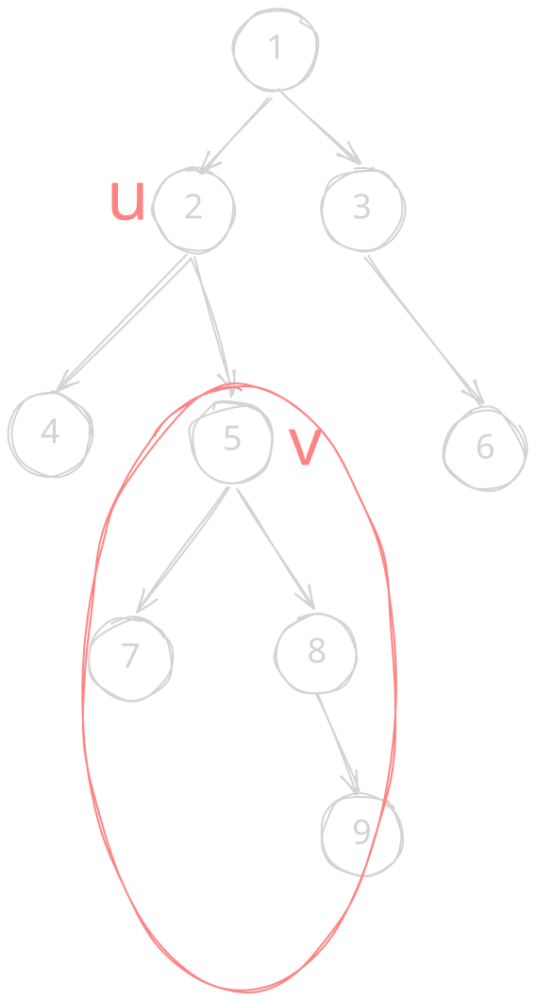

困死，打得非常差，不过居然因为分数还没饱和所以还加了几十分。疯狂吃罚时……不过题目确实都不算很难。

## [A. Maximize One MEX](https://codeforces.com/contest/2272/problem/A)

**题意：** 给定 $0,1,\dots,n-1$ 的排列 $a_i$，你可以交换其中的两个元素，求第 $k$ 大的前缀 mex 最大时进行的操作（如果不交换输出 $-1$）。

贪心。不难发现第 $k$ 大的前缀 mex 来自于前 $n-k+1$ 个元素的空缺或恰好为 $n-k+1$。直接考虑将前面最小的空缺元素与任意一个超过范围进行交换。

```cpp
void solve() {
    int n, k, l = 0, r = 0;
    fr(n, k);
    vector<int> a(n), p(n);
    fr(a);
    for (auto [i, x] : a | views::enumerate) p[x] = i;
    vector<bool> vis(n + 1);
    for (int i = 0; i <= n - k; ++i) vis[a[i]] = 1;
    for (; l <= n - k + 1 && vis[l]; ++l);
    if (l == n - k + 1) return fwn(-1);
    for (r = l + 1; r <= n - k && vis[r]; ++r);
    for (int i = 0; i <= n - k; ++i)
        if (a[i] >= r) return fwn(i + 1, p[l] + 1);
}
```

**std 做法：** 考虑直接将前 $n-k+1$ 个数中的最大值与后段的最小值交换。显然如果最大值大于最小值，该交换肯定能让第 $k$ 大的 mex 更大。否则不需交换。

```cpp
#include <bits/stdc++.h>
using namespace std;

int main() {
    ios::sync_with_stdio(false);
    cin.tie(nullptr);
    int t;
    cin >> t;
    while (t--) {
        int n, k;
        cin >> n >> k;
        vector<int> a(n);
        for (int i = 0; i < n; i++) cin >> a[i];

        if (k == 1) {
            cout << -1 << '\n';
        } else {
            auto x = max_element(a.begin(), a.begin() + n - k + 1) - a.begin();
            auto y = min_element(a.begin() + n - k + 1, a.end()) - a.begin();
            if (a[x] > a[y]) {
                cout << x + 1 << ' ' << y + 1 << '\n';
            } else {
                cout << -1 << '\n';
            }
        }
    }
    return 0;
}
```

## [B. Frogs Jump](https://codeforces.com/contest/2272/problem/B)

**题意：** 给定 $2 \times n$ 方格，上面有一些青蛙（保证每列至少一只）。你可以删去部分青蛙，要求删去之后存在一个方案使得每只青蛙都向四个方向之一跳且不离开方格（可以在同一格里）且每行每列的青蛙数不变。求删去青蛙的最小值。

贪心。不难发现答案只能是 $1$ 或者 $0$。如果某一列上下相同，那么这列不需要删除。如果上下不同，那么答案改变。也就是说如果有偶数列上下不同，答案为 $0$，反之亦然。

```cpp
void solve() {
    int n, ans = 0;
    fr(n);
    string a, b;
    fr(a), fr(b);
    for (int i = 0; i < n; ++i)
        if (a[i] ^ b[i]) ans ^= 1;
    fwn(ans);
}
```

## [C. Yet Another Black Cell Problem](https://codeforces.com/contest/2272/problem/C)

**题意：** 有一列初始为白色的方格覆盖 $[0,10^9]$，给定 $n$ 个数 $a_i$ 表示要染色的位置。你可以增加不超过 $x$ 个位置染色。确定位置后每次染色选择距离不超过 $k$ 的两个格子染色。求完成最终染色且没有将其他格子染色的最小可行 $k$。

显然 $k$ 充分大时一定可行，考虑二分答案。我们可以从小到大枚举要染色的位置。先特判掉相邻位置较近的。剩余部分要么在两个点中间增加一个同时完成两个，要么分别在距离当前点为 $1$ 的地方增加一个点。显然这是 $O(n)$。

```cpp
void solve() {
    int n, x;
    fr(n, x);
    vector<int> a(n + 1);
    frn(a, n);
    auto check = [&](int m) -> bool {
        vector<bool> f(n + 1);
        for (int i = 1; i <= n; ++i)
            f[i] = (i > 1 && a[i] - a[i - 1] <= m)
                || (i < n && a[i + 1] - a[i] <= m);
        int cnt = 0;
        for (int i = 1; i <= n; ++i) {
            if (f[i]) continue;
            if (i < n && !f[i + 1] && (a[i + 1] - a[i]) <= (m << 1)) ++cnt, ++i;
            else ++cnt;
        }
        return cnt <= x;
    };
    int l = 1, r = 1e9;
    while (l < r) {
        int m = (l + r) >> 1;
        if (check(m)) r = m;
        else l = m + 1;
    }
    fwn(l);
}
```

## [D. Connecting the Conflicts](https://codeforces.com/contest/2272/problem/D)

**题意：** 给一个根数量为 $k$ 的森林，在其中增加 $k-1$ 条边连接为新树使得新树的最大独立集最大。求连接边的一个方案。

神题。比较综合的 DP 题。

首先由[没有上司的舞会](https://www.luogu.com.cn/problem/P1352)不难知道最大独立集的求法是树形 DP：（设 $g(u,0/1)$ 为不选/选 $u$ 的最大子树独立集大小，叶子处 $g(u,1)=1$）

$$
g(u,0)=\sum_{v\in s_u}\max(g(v,0),g(v,1))
$$
$$
g(u,1)=\sum_{v\in s_u}g(v,0)
$$

接下来尝试换根求出每个点为根时的选或不选的最大独立集。如图：



设 $h(u,0/1)$ 为不选/选 $u$ 在 $u$ 为根时的最大独立集。

由图发现可以差分：

$$
h(v,0)=\max(h(u,0)-\max(g(v,0),g(v,1)),h(u,1)-g(v,0))+g(v,0)
$$
$$
h(v,1)=h(u,0)-\max(g(v,0),g(v,1))+g(v,1)
$$

一棵树算完之后求出整棵树中最大的 $h$ 值对应的节点存进 $f$，于是我们将这些树根据其选/不选的值的大小关系分类。将其中不选的值较大的那类为根，显然这类可以连接所有其他点。

如果这类为空，也就是所有树都是选的值较大，在其中选择差值最小的那个树作为根来连接即可。

```cpp
void solve() {
    int k;
    fr(k);
    vector<array<int, 2>> f(k + 1, { -1, -1 }), fp(k + 1);
    for (int i = 1, n; i <= k; ++i) {
        fr(n);
        vector<vector<int>> gr(n + 1);
        vector<array<int, 2>> g(n + 1), h(n + 1);
        for (int j = 1, u, v; j < n; ++j) {
            fr(u, v), gr[u].emplace_back(v), gr[v].emplace_back(u);
        }
        if (k == 1) return fwn(0);
        auto dfs = [&](this auto&& self, int u, int fa) -> void {
            for (int v : gr[u])
                if (v != fa) {
                    self(v, u), g[u][0] += max(g[v][1], g[v][0]);
                    g[u][1] += g[v][0];
                }
            ++g[u][1];
        };
        dfs(1, 0), h[1] = g[1];
        auto dfs2 = [&](this auto&& self, int u, int fa) -> void {
            for (int v : gr[u]) {
                if (v != fa) {
                    int tmp = h[u][0] - max(g[v][0], g[v][1]);
                    h[v][0] = g[v][0] + max(tmp, h[u][1] - g[v][0]);
                    h[v][1] = g[v][1] + tmp, self(v, u);
                }
            }
        };
        dfs2(1, 0);
        for (int u = 1; u <= n; ++u) {
            for (int j = 0; j < 2; ++j)
                if (f[i][j] < h[u][j]) fp[i][j] = u, f[i][j] = h[u][j];
        }
    }
    vector<bool> s(k + 1);
    int rt = 0, cnt = 0;
    for (int i = 1; i <= k; ++i) {
        if (f[i][1] > f[i][0]) s[i] = 1, ++cnt;
        else if (!rt) rt = i;
    }
    if (cnt == k) {
        int mn = 1e9, cur = 0;
        for (int i = 1; i <= k; ++i)
            if (mn > f[i][1] - f[i][0]) mn = f[cur = i][1] - f[i][0];
        s[cur] = 0, rt = cur;
    }
    for (int i = 1; i <= k; ++i) {
        if (i == rt) continue;
        fwn(rt, fp[rt][0], i, fp[i][s[i]]);
    }
}
```

看了题解之后惊奇的发现原来能这么简单吗……被题解薄纱了。

**std 做法：** 直接贪心取某个森林的叶子节点的父节点，不难发现整个树必然存在一个最大独立集不包含该点（如果包含可以将这个点换为它的子节点（叶子）肯定不会变差）。于是用该点作为根连接其他所有树的任意节点即可。如果没有叶子都是孤立点，那么就任选即可。

```cpp
#include<bits/stdc++.h>
using namespace std;

int main() {
    int t;
    cin >> t;
    while (t--) {
        int k;
        cin >> k;
        vector<vector<vector<int>>> trees(k);
        for (int i = 0; i < k; i++) {
            int n;
            cin >> n;
            trees[i].assign(n, {});
            for (int j = 0; j < n - 1; j++) {
                int x, y;
                cin >> x >> y;
                x--, y--;
                trees[i][x].push_back(y);
                trees[i][y].push_back(x);
            }
        }

        int ri = -1, rj = -1;
        for (int i = 0; i < k && ri == -1; i++) {
            if (trees[i].size() > 1) {
                for (int j = 0; j < trees[i].size() && ri == -1; j++) {
                    if (trees[i][j].size() == 1) {
                        ri = i, rj = trees[i][j][0];
                    }
                }
            }
        }
        if (ri == -1) ri = rj = 0;
        for (int i = 0; i < k; i++) {
            if (i == ri) continue;
            cout << i + 1 << " 1 " << ri + 1 << " " << rj + 1 << "\n";
        }
    }
    return 0;
}
```

## [E. Memory Cell Interception](https://codeforces.com/contest/2272/problem/E)

**题意：** 给定一个初始为 $0$ 的数和两个仅包含 `RW` 的字符串，可以在不改变某个字符串内部的顺序的情况下将两个字符串穿插成一个字符串。完成后从左向右计算，若为 `R` 输出当前数值；若为 `W` 将该数修改为当前下标。对于两个字符串求出每个 `R` 能读出的不同数值有多少种。

贪心+后缀和神题。

先考虑某一个字符串，将另一个插入进来。

如果当前位置 $i$ 的一个 `R` 之前最近的 `W` 在下标 $j$，那么将另一个字符串（长度为 $m$）的前缀插入 $j$ 前，剩余插到 $i$ 后面。不难发现此时该 $R$ 读出的范围为 $[j,j+m]$。再考虑插到中间，设插入串的最后一个 `W` 的下标为 $k$，那么答案为 $[i,i+k-1]$。

再考虑当前位置前面没有 `W`，那么答案由另一个字符串中的所有 `W` 决定。对于每一个下标为 $j$ 的字符 `W`，都会贡献一个区间 $[j,i+j-1]$。直接朴素合并这些区间是 $O(nm)$ 的，我们可以先预处理每个位置何时出现区间合并。两个区间重合当且仅当 $i>j-j'$，直接枚举 `W` 所在下标进行更新即可。随后再做一个后缀和就能知道每个位置 $i$ 之后还有多少个活动区间，每次答案就增加活动区间数，就能得到当前区间覆盖的长度范围了。

```cpp
void solve() {
    array<int, 2> n;
    array<string, 2> s;
    fr(n[0], n[1]), fr(s[0]), fr(s[1]);
    for (auto& x : s) x = ' ' + x;
    auto calc = [&](int id) {
        int k = 0, cnt = 0;
        vector<int> pos, suf(n[0] + n[1] + 1);
        for (int i = 1; i <= n[id ^ 1]; ++i)
            if (s[id ^ 1][i] == 'W') ++cnt, pos.emplace_back(i), k = i;
        for (int i = 0; i + 1 < pos.size(); ++i) ++suf[pos[i + 1] - pos[i] - 1];
        if (k) ++suf[n[0] + n[1]];
        for (int i = n[0] + n[1]; i; --i) suf[i - 1] += suf[i];
        for (int i = 1, c = 0; i <= n[id]; ++i) {
            if (s[id][i] == 'R') {
                if (!c) fw(cnt + 1), fw(' '), cnt += suf[i];
                else fw(max(c + n[id ^ 1], k ? i + k - 1 : 0) - c + 1), fw(' ');
            } else c = i;
        }
    };
    calc(0), calc(1);
}
```
