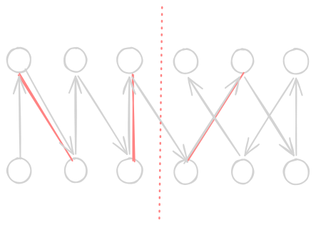

## [A. In Search of Convenience](https://codeforces.com/contest/2275/problem/A)

**题意：** 求任意一个离给定点距离为 $r$ 的点。

签到题，显然直接取坐标轴上差 $r$ 就行


## [B. Did Not Go to Print](https://codeforces.com/contest/2275/problem/B)

**题意：** 有 $n$ 个文件和 $n$ 次操作，每次操作有三种，分别将文件 $i$ 放到内存中、从内存中打印最上方的或者 $i$、和直接打印 $i$，求操作完后哪些文件未被打印。

签到题，直接依题意模拟即可。


## [C. Unrequited Love](https://codeforces.com/contest/2275/problem/C)

**题意：** 给定 $n$ 个整数 $a_i$，在其中选出三个元素下标满足公差为 $2$ 的等差数列，其产生 $a_i+a_{i+2}-a_{i+4}$ 的贡献。求贡献相同且没有重合的三元组个数。

赛场上犯蠢了，本来应该快速想到的浪费了不少时间。

考虑正难则反，先开个桶记录每个贡献有多少个三元组，然后任选两个求和得到总答案。再枚举每一组与其相邻的组中是否有贡献相等的，如果有就减去即可。复杂度：$O(n)$，代码中的 `int128` 是没有必要的。

```cpp
void solve() {
    using lll = __int128_t;
    int n;
    fr(n);
    vector<ll> a(n + 1);
    frn(a, n);
    lll ans = 0;
    unordered_map<ll, lll> cnt;
    for (int i = 5; i <= n; ++i) ++cnt[a[i - 4] + a[i - 2] - a[i]];
    for (auto [x, y] : cnt) ans += (y * (y - 1)) >> 1;
    for (int i = 7; i <= n; ++i) {
        for (int j = i - 4; j < i; j += 2) {
            if (j < 5) continue;
            if (a[i - 4] + a[i - 2] - a[i] == a[j - 4] + a[j - 2] - a[j]) --ans;
        }
    }
    fwn(ans);
}
```


## [D. Precision Alignment](https://codeforces.com/contest/2275/problem/D)

**题意：** 给定 $3$ 个长度为 $n$ 的序列 $a_i,b_i,c_i$， 可以对其进行不超过 $k$ 次操作。每次操作选定一个序列（如 $a_i$），然后比较其下一个数列与下下个的大小关系并相减。确切地说，就是 $a_i+=sig(b_i,c_i)$。求操作后 $\min_i(a_i+b_i+c_i)$ 的最大值。

二分答案板子，但有一些细节需要注意。

首先注意到 **最小值最大** 的字眼，我们来试着二分答案。考虑如何判断 $min(a+b+c)$ 能否达到 $m$，发现这是显然的，只需先特判掉已经超过 $m$ 的，其余如果不是 $a<b<c$，就可以直接给最大值增加，从而使用 $m-a-b-c$ 次操作即可达到 $m$。而如果是 $a<b<c$，就需要先让 $b$ 或 $c$ 减小直到碰到上一个数，随后转换为前面的情况，再统计答案即可。注意二分答案的边界要取到 $2\times 10^{18}$。最终复杂度为 $O(n\log n)$。

```cpp
void solve() {
    ll n, k, ans = LLONG_MAX;
    fr(n, k);
    vector<tuple<ll, ll, ll>> v;
    for (int i = 1, a, b, c; i <= n; ++i) {
        fr(a, b, c);
        if (a == b && b == c) ans = min(ans, (ll)a + b + c);
        else v.emplace_back(a, b, c);
    }
    auto check = [&](ll m) {
        ll cur = 0;
        for (auto [a, b, c] : v) {
            if (a + b + c >= m) continue;
            if (a <= b && b <= c) {
                ll tmp = b - a + 1 + m - ((a << 1) - 1 + c);
                if (a < b) tmp = min(tmp, c - b + 1 + m - ((b << 1) - 1 + a));
                cur += tmp;
            } else cur += m - a - b - c;
            if (cur > k) return false;
        }
        return cur <= k;
    };
    ll l = -2e18, r = 2e18;
    while (l < r) {
        ll m = (l + r + 1) >> 1;
        if (check(m)) l = m;
        else r = m - 1;
    }
    fwn(min(ans, l));
}
```


## [E. Repentance Is Already on the Way](https://codeforces.com/contest/2275/problem/E)

**题意：** 给两个长度为 $n$ 的序列，将对应下标差值不超过 $1$ 的两个位置连边权为 $1$ 的边，其中如果这两个位置的数对应相等，边权为 $2$。求能够经过所有 $2n$ 个点的路径长度的最大值。

小清新构造题，略微考察注意力。

先考虑所有这样的路径有几条，随便列一下发现只有 $n$ 条，再找找规律，如图：


显然所有指向右下的路径是必选的，在虚线前的正向的是必选的，虚线后的右上和最后一个正向是必选的。这样我们可以前缀和计算出在这前面一共有多少个该类型的边，然后比较就行。复杂度为 $O(n)$。

```cpp
void solve() {
    int n;
    fr(n);
    vector<int> a(n + 1), b(n + 1), f(n + 1), g(n + 1), h(n + 1);
    frn(a, n), frn(b, n);
    for (int i = 1; i <= n; ++i) {
        h[i] = h[i - 1] + (a[i] == b[i]), g[i] = g[i - 1] + (a[i] == b[i - 1]);
        f[i] = f[i - 1] + (a[i - 1] == b[i]);
    }
    int ans = 0;
    for (int i = 1; i <= n; ++i) ans = max(ans, h[i - 1] + f[n] - f[i]);
    fwn(ans + (n << 1) - 1 + (a[n] == b[n]) + g[n]);
}
```


