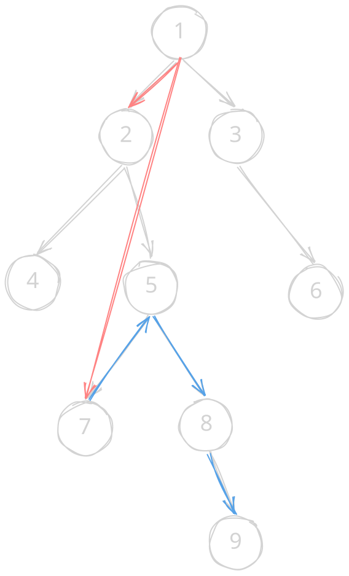

打得还行的一场 cf，虽然后面基本上没有提交了，但后面的题确实已经超过了能力范围。

AB 是签到，跳过。

## [C Edge Addeleting](https://codeforces.com/contest/2277/problem/C)

**题意：** 给一棵树，给 $m$ 次操作，每次操作将给定 $u_i$ 与根节点连边形成环，随后删去环上的一条边使得变回树。求操作结束后根节点到 $n$ 号节点的最大距离。

贪心+LCA

考虑先 dfs 求出每个点所属的子树。每次操作时，如果 $u_i$ 与 $n$ 不在同一个子树，则对结果没有影响直接跳过。否则如图：



比如将 $1,7$ 连接，再断开 $1,2$。不难发现此时 $1,9$ 最远，距离为 $1+d_7+d_9-2d_5$。多推几个例子发现最优情况就是贪心断开子树根到根节点的边，答案从 $d_n$ 变为 $1+d_n+d_u-2d_{lca}$。然后 LCA 可以用 ST 表维护祖先即可。

```cpp
void solve() {
    int n, m;
    fr(n, m);
    vector<vector<int>> gr(n + 1);
    for (int u, v, i = 1; i < n; ++i)
        fr(u, v), gr[u].emplace_back(v), gr[v].emplace_back(u);
    vector<int> rt(n + 1), dep(n + 1, -1);
    vector<array<int, 30>> f(n + 1);
    auto dfs = [&](this auto&& self, int u, int fa) -> void {
        rt[u] = (fa == 1 ? u : rt[fa]), dep[u] = dep[fa] + 1, f[u][0] = fa;
        for (int i = 1; i < 30; ++i) f[u][i] = f[f[u][i - 1]][i - 1];
        for (int v : gr[u])
            if (v != fa) self(v, u);
    };
    auto lca = [&](int u, int v) {
        if (dep[u] < dep[v]) swap(u, v);
        for (int i = 29; i >= 0; --i)
            if (dep[f[u][i]] >= dep[v]) u = f[u][i];
        if (u == v) return u;
        for (int i = 29; i >= 0; --i)
            if (f[u][i] != f[v][i]) u = f[u][i], v = f[v][i];
        return f[u][0];
    };
    dfs(1, 1);
    int ans = dep[n];
    for (int u; m--;) {
        fr(u);
        if (u == 1) continue;
        if (rt[u] == rt[n])
            ans = max(ans, 1 + dep[u] + dep[n] - (dep[lca(u, n)] << 1));
    }
    fwn(ans);
}
```

## [D1 Number Operating (Easy Version)](https://codeforces.com/contest/2277/problem/D1)

**题意：** 从 $0$ 开始每次选择两个操作之一，操作一将值增加 $2^k$，其中 $k$ 为此操作前连续操作一的次数；操作二为将值减一。给定 $l,r$，求分别达到 $[l,r]$ 内的每一个整数的最小操作次数之和。（弱化版要求：$r - l \le 2 \times 10^5$）

注意到范围限制，直接枚举每个位置，设 $f(x)$ 为达到 $x$ 所需的最少操作次数。由 $2^k < x \le 2^{k+1}$，发现最优情况只有两种，就是先做 $k$ 次操作，用操作二打断，再补齐剩下的；或者直接做 $k+1$ 次操作，然后再减回去。可以列出递归式：

$$
f(n) = \min(m+2^{m+1}-n,\ f(n-2^m+2)+m+1) \quad (m = \lfloor \log n \rfloor \ge 2)
$$

然后直接写就行：

```cpp
void solve() {
    const int mod = 998244353;
    ll l, r, ans = 0;
    fr(l, r);
    auto f = [](this auto&& self, ll n) -> ll {
        if (!n) return 0;
        ll m = __lg(n), ans = m + (1ll << (m + 1)) - n;
        if (m >= 2) ans = min(ans, self(n - (1ll << m) + 2) + m + 1);
        return ans;
    };
    for (ll i = l; i <= r; ++i) { ans = (ans + f(i) % mod + mod) % mod; }
    fwn(ans);
}
```