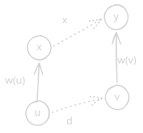

> 来源：[P2024 [NOI2001] 食物链](https://www.luogu.com.cn/problem/P2024)

**题意：** $n$ 个生物互相存在进食或同类关系，给 $k$ 组关系求有多少组与之前矛盾。

## 做法一：带权并查集

考虑在并查集上额外维护一个点权 $w_i$ 表示 $i$ 与 $fa_i$ 的关系，如果 $w_i=0$ 表示 $i$ 与 $fa_i$ 是同类；如果 $w_i=1$ 就是 $i$ 吃 $fa_i$，以此类推。不难发现只需在 `getf` 和 `merge` 时持续维护点权就行。压缩时先找到根节点，随后将自己的权值与原来的父节点权值相加，令 $t_i$ 为 $i$ 到根的关系值，则有 $w_i=t_i-t_f,w_i+w_f=t_i-t_f+t_f-t_r=t_i-t_r$，恰好得到当前点到根的点权。而 `merge` 时如图：



我们可以列出式子 $w_u+w_x=d+w_v,w_x=d+w_v-w_u$。代码如下：

```cpp
void solve() {
    int n, k, ans = 0;
    fr(n, k);
    vector<int> fa(n + 1), w(n + 1);
    auto getf = [&](this auto&& self, int x) -> int {
        if (fa[x] == x) return x;
        int f = self(fa[x]);
        return w[x] = (w[x] + w[fa[x]]) % 3, fa[x] = f;
    };
    auto merge = [&](int u, int v, int d) {
        int x = getf(u), y = getf(v);
        w[x] = (w[v] - w[u] + d + 3) % 3, fa[x] = y;
    };
    ranges::iota(fa, 0);
    for (int op, x, y; k--;) {
        fr(op, x, y);
        if (x > n || y > n) {
            ++ans;
            continue;
        }
        if (op == 1) {
            if (getf(x) == getf(y)) {
                if (w[x] != w[y]) ++ans;
                continue;
            }
            merge(x, y, 0);
        } else {
            if (getf(x) == getf(y)) {
                if ((w[x] - w[y] + 3) % 3 != 1) ++ans;
                continue;
            }
            merge(x, y, 1);
        }
    }
    fwn(ans);
}
```

## 做法二：扩展域并查集

考虑直接开三倍空间的并查集，`a+n` 表示 `a` 的食物，`a+2n` 表示 `a+n` 的食物，`a` 表示 `a+2n` 的食物，同类直接放到同一个并查集就行，实现非常简单，但有个大常数。

```cpp
void solve() {
    int n, k, ans = 0;
    fr(n, k);
    vector<int> fa(n * 3 + 1);
    ranges::iota(fa, 0);
    auto getf = [&](this auto&& self, int x) -> int {
        return x == fa[x] ? x : fa[x] = self(fa[x]);
    };
    for (int op, x, y; k--;) {
        fr(op, x, y);
        if (x > n || y > n) {
            ++ans;
            continue;
        }
        if (op == 1) {
            if (getf(x) == getf(y + n) || getf(x) == getf(y + n * 2)) {
                ++ans;
                continue;
            }
            fa[getf(x)] = getf(y), fa[getf(x + n)] = getf(y + n);
            fa[getf(x + 2 * n)] = getf(y + 2 * n);
        } else { // a>a+n>a+2n>a
            if (getf(x) == getf(y) || getf(x) == getf(y + n)) {
                ++ans;
                continue;
            }
            fa[getf(x)] = getf(y + 2 * n), fa[getf(x + n)] = getf(y);
            fa[getf(x + 2 * n)] = getf(y + n);
        }
    }
    fwn(ans);
}
```

## 总结与对比

| 项目 | 带权并查集 | 扩展域并查集 |
| --- | --- | --- |
| 时空间复杂度 | 时间近似 $O(n)$，空间 $O(n)$（两个数组） | 时间近似 $O(kn)$ 常数是扩展域个数，空间同 |
| 实现难度 | 略高，注意关注 `getf` 函数的实现顺序 | 极低，和普通并查集完全一致 |
| 常用题目 | 维护数值关系如差值等，要可合并（群关系） | 类别关系，能简单分类且类关系有类似传递性 |
