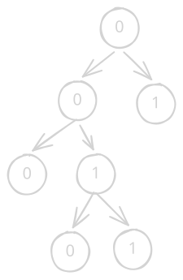

> 来源：[P4551 最长异或路径](https://www.luogu.com.cn/problem/P4551)

**题意：** 给一棵有边权的树，求其路径中异或和的最大值。

## 思路与代码

先把树建出来，然后 dfs 维护根到当前点的异或和。由于异或可差分，任意路径异或和等于这两个端点到根的路径的异或和。接下来考虑如何求给定序列中两个数异或值最大。考虑如图建树：




将每个数的二进制位从高到低（此题为例就是从 $30$ 到 $0$）插入二叉树中，每个叶子位置非零代表一个前缀存在。当需要查询某个数异或最大的对时，只需要贪心地向相反方向跳就行，因为高位得到 $1$ 一定优于高位得到 $0$。然后发现每一个数要插入会新增 $\log v$ 个点，则需要开 $32$ 倍空间，时间复杂度相同为 $O(n\log v)$。

```cpp
void solve() {
    int n, c = 0, ans = 0;
    fr(n);
    vector<vector<pair<int, int>>> gr(n + 1);
    for (int u, v, w, i = 1; i < n; ++i)
        fr(u, v, w), gr[u].emplace_back(v, w), gr[v].emplace_back(u, w);
    vector<int> sum(n + 1);
    auto dfs = [&](this auto&& self, int u, int fa) -> void {
        for (auto [v, w] : gr[u])
            if (v != fa) sum[v] = sum[u] ^ w, self(v, u);
    };
    dfs(1, 0);
    vector<array<int, 2>> tr(n << 5 | 1);
    auto insert = [&](int v) {
        for (int p = 0, t, b = 30; b >= 0; --b)
            t = (v >> b) & 1, p = tr[p][t] ? tr[p][t] : tr[p][t] = ++c;
    };
    auto query = [&](int v) {
        int ret = 0;
        for (int p = 0, b = 30; b >= 0; --b) {
            int t = (v >> b) & 1;
            if (tr[p][t ^ 1]) p = tr[p][t ^ 1], ret += (1 << b);
            else p = tr[p][t];
        }
        return ret;
    };
    for (int i = 1; i <= n; ++i) insert(sum[i]);
    for (int i = 1; i <= n; ++i) ans = max(ans, query(sum[i]));
    fwn(ans);
}
```