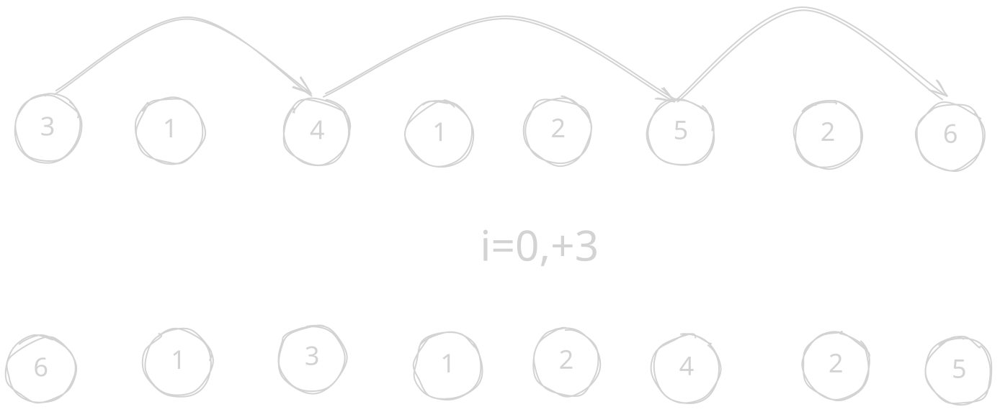

> 来源：[T403456 [NNSZCP-2023] 排序算法](https://www.luogu.com.cn/problem/T403456)

**题意：** 根据题目所给代码求交换次数。

原做法特别复杂（可能达到 2400）但整理之前的内容时偶然发现了更简单的做法。

## 思路

发现 $i=0$ 的时候最奇怪，相当于将前缀最大值移到前面，如图：



之后每次操作只需要将新的元素插入前面，交换时也只需考虑新的元素。也就是在当前元素前面而且比这个数大的不同元素个数。这个显然可以离散化后用树状数组维护！

## 代码

```cpp
void solve() {
    int n;
    fr(n);
    vector<ll> a(n), pre(n);
    fr(a);
    int m = [&]() {
        auto b = a;
        ranges::sort(b), b.erase(unique(b.begin(), b.end()), b.end());
        for (auto& x : a) x = ranges::lower_bound(b, x) - b.begin() + 1;
        return b.size();
    }();
    ll ans = 0;
    for (int j = 0; j < n; ++j)
        if (a[0] < a[j]) ++ans, swap(a[0], a[j]);
    vector<ll> tr(m + 1);
    vector<bool> vis(m + 1);
    auto mod = [&](int p) {
        for (; p <= m; p += p & -p) ++tr[p];
    };
    auto qry = [&](int p) {
        ll ans = 0;
        for (; p; p -= p & -p) ans += tr[p];
        return ans;
    };
    for (int i = 0; i < n; ++i) {
        ans += qry(m) - qry(a[i]);
        if (!vis[a[i]]) mod(a[i]), vis[a[i]] = 1;
    }
    fwn("YES"), fwn(ans);
}
```

这样可比原来简单多了。