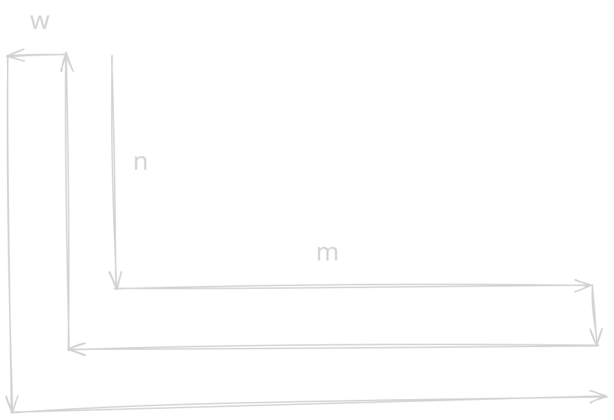

这是 Div. 2？感觉明显比较简单吧，然后一看主页，入门到省选-，确实比较简单，但 T5 确实不会了。413pts rk30-

## [A 花开伊吕波](https://www.luogu.com.cn/problem/P17901)

**题意：** 给定正整数 $w,n,m$，求出从 $n\times m$ 方格左下角延伸出去的宽度为 $w$ 的格子依次经过的用时，每单位时间移动一格或者转向。

这个题意没说清楚，如图，


就是这个图的意思，然后直接模拟算就行。每层比上一层多两格，然后加上转角的个数即可。

```cpp
void solve() {
    int w, x, y;
    fr(w, x, y);
    ll ans = 3 * (w - 1);
    for (int cur = x + y + 1; w--;) { ans += cur, cur += 2; }
    fwn(ans);
}
```

## [B 白箱](https://www.luogu.com.cn/problem/P17902)

**题意：** 给定 $n$ 集动画需要制作，第一集从 $s$ 开始播放，此后两集间隔 $t$，每集可以花费 $[l_i,r_i]$ 的时间制作，每花费一个单位的时间就可以获得 $q_i$ 价值。求最大价值。

我可能做麻烦了，反正过了就行。

考虑设初始时间均为 $l_i$，判断一下现在是否能完成，如果不能就无解。于是列出要求：
$$
\left\{\begin{matrix} 
  p_i\le s+(i-1)t \\  
  l_i\le d_i\le r_i 
\end{matrix}\right. 
$$

其中 $d_i$ 代表第 $i$ 集消耗的时间，$p_i$ 代表 $d_i$ 的前缀和。

然后贪心，按照 $q_i$ 从大到小做，某个 $d_i$ 增加 $x$ 会使 $[i,n]$ 的所有 $p$ 都增加 $x$，于是 $p_j+x\le s+(j-1)t$，同时 $x\le r_i-l_i$，保证不会超过 $r_i$。

然后我们发现某个位置的 $x$ 可以直接计算：
$$
x=\min(r_i-l_i,\min_{j=i}^n(s+(j-1)t-p_j))
$$

观察这个式子后面的部分相当于是区间 min，然后对某个位置增加 x 相当于区间加，直接上线段树维护即可。

```cpp
struct L {
    ll v = 0;
    void operator+=(L o) { v += o.v; }
};
struct V {
    ll v = 0, l = 0, r = 0;
    V(ll v = 0, int l = 0, int r = 0) : v(v), l(l), r(r) { }
    void operator+=(L o) { v += o.v; }
};
V operator+(V l, V r) { return { min(l.v, r.v), l.l, r.r }; }
void solve() {
    ll n, s, t, ans = 0;
    fr(n, s, t);
    vector<ll> q(n + 1), l(n + 1), r(n + 1), a(n + 1), rk(n);
    frn(q, n), ranges::iota(rk, 1);
    for (int i = 1; i <= n; ++i) fr(l[i], r[i]), ans += l[i] * q[i];
    for (ll cur = 0, i = 1; i <= n; ++i)
        if ((cur += l[i]) > s + t * (i - 1)) return fwn("Bansakutsukita!");
    for (ll i = 1, sum = 0; i <= n; ++i) a[i] = s + t * (i - 1) - (sum += l[i]);
    vector<V> val(n << 2 | 1);
    vector<L> laz(n << 2 | 1);
    auto ls = [](int x) { return x << 1; };
    auto rs = [](int x) { return x << 1 | 1; };
    auto build = [&](this auto&& self, int x, int l, int r) -> void {
        if (l == r) return val[x] = V(a[l], l, r), void();
        int m = (l + r) >> 1;
        self(ls(x), l, m), self(rs(x), m + 1, r);
        val[x] = val[ls(x)] + val[rs(x)];
    };
    auto pushdown = [&](int x) {
        if (laz[x].v) {
            laz[ls(x)] += laz[x], laz[rs(x)] += laz[x];
            val[ls(x)] += laz[x], val[rs(x)] += laz[x], laz[x] = L();
        }
    };
    auto query = [&](this auto&& self, int x, int l, int r) -> V {
        if (l <= val[x].l && val[x].r <= r) return val[x];
        int m = (val[x].l + val[x].r) >> 1;
        pushdown(x);
        if (l > m) return self(rs(x), l, r);
        else if (r <= m) return self(ls(x), l, r);
        return self(ls(x), l, r) + self(rs(x), l, r);
    };
    auto modify = [&](this auto&& self, int x, int l, int r, L v) -> void {
        if (l <= val[x].l && val[x].r <= r) return val[x] += v, laz[x] += v;
        int m = (val[x].l + val[x].r) >> 1;
        pushdown(x);
        if (l <= m) self(ls(x), l, r, v);
        if (r > m) self(rs(x), l, r, v);
        val[x] = val[ls(x)] + val[rs(x)];
    };
    build(1, 1, n), ranges::sort(rk, [&](int a, int b) { return q[a] > q[b]; });
    for (auto i : rk) {
        ll d = min(r[i] - l[i], query(1, i, n).v);
        ans += q[i] * d, modify(1, i, n, L { -d });
    }
    fwn(ans);
}
```

std 做法：

考虑反悔贪心，先假定所有的都用 $r_i$ 时间，然后用个小根堆把价值和剩余长度放进去，如果当前的时间不够了就贪心取最小价值的拿来去掉并且更新答案。然后就行了。绷。属于是黄题当青题了。

```cpp
void solve() {
    ll n, s, t;
    fr(n, s, t);
    vector<ll> q(n + 1);
    frn(q, n);
    priority_queue<pair<ll, ll>, vector<pair<ll, ll>>, greater<>> pq;
    ll ans = 0;
    bool flag = 1;
    for (ll l, r, i = 1; i <= n; ++i, s += t) {
        fr(l, r), ans += q[i] * r, s -= r, pq.emplace(q[i], r - l);
        while (pq.size() && s < 0) {
            auto [v, d] = pq.top();
            pq.pop();
            ll c = min(-s, d);
            ans -= c * v, s += c;
            if (d > c) pq.emplace(v, d - c);
        }
        if (s < 0) flag = 0;
    }
    if (!flag) fwn("Bansakutsukita!");
    else fwn(ans);
}
```

## [C 樱花任务](https://www.luogu.com.cn/problem/P17903)

**题意：** 给定 $n$ 个变量以及数组 $a_i$，构造一个命题任意或存在 $x_i\in \{0,a_i\}$ 满足 $\sum x_i\bmod m\in [l,r]$，求命题为真的存在或任意选法个数。

爆搜+二进制优化。

不妨将 $x_i$ 取值压缩进 bitset 中，然后提前求出和判断是否在范围内。然后从 $x_1$ 开始判断，如果选择 $\exists$ 那么就相当于相邻位置或一下，选 $\forall$ 就相当于相邻位置与一下，然后逐层递归即可，复杂度为 $O(n2^n)$。

```cpp
using B = bitset<1 << 20>;
void solve() {
    int n, m, l, r;
    fr(n, m, l, r);
    vector<ll> a(n), ans(n + 1);
    fr(a);
    vector<B> st(n + 1);
    for (int i = 0; i < (1 << n); ++i) {
        ll s = 0;
        for (int j = 0; j < n; ++j)
            if ((i >> j) & 1) s = (s + a[n - j - 1]) % m;
        st[n][i] = (s >= l) && (s <= r);
    }
    auto dfs = [&](this auto&& self, int dep, int cnt) -> void {
        if (!dep--) return ans[cnt] += st[0][0], void();
        for (int i = 0; i < (1 << dep); ++i)
            st[dep][i] = st[dep + 1][i << 1] | st[dep + 1][i << 1 | 1];
        self(dep, cnt);
        for (int i = 0; i < (1 << dep); ++i)
            st[dep][i] = st[dep + 1][i << 1] & st[dep + 1][i << 1 | 1];
        self(dep, cnt + 1);
    };
    dfs(n, 0);
    fwn(ans);
}
```

## [D 白沙的水族馆（normal version）](https://www.luogu.com.cn/problem/P17904)

**题意：** 给定 $n,l,r$，求 $\sum_{k=l}^rf(k)$，其中 
$$
f(k)=\sum_{k=1}^{n}
\left[\forall i\in[1,k],\ \gcd\!\left(x,\binom{k}{i}\right)=1\right]
$$

数论结论题。

由 Lucas 定理，$\binom{n}{k} \equiv\binom{\lfloor n / p\rfloor}{\lfloor k / p\rfloor}\binom{ n \bmod p}{k \bmod p} \quad(\bmod p)$ 然后依次递推，于是只有在 $p$ 进制下除了最高位均为 $p-1$ 才能整行与 $p$ 互质，于是就有仅有 $k=cp^t-1,c\in[2,p],t\ge 0$ 时任意一个以 $p$ 为底的组合数与 $k$ 互质。

再考虑将 $k$ 质因数分解，考虑最小的两个质因数 $p,q$，于是因为 $k+1=c_1p^{t_1}=c_2q^{t_2}$，这里对比一下系数就会发现 $k+1\le\max(p,q)$。这样就直接暴力计算即可（只需考虑一个质数 $\min(p,q)$）

注意这题超级卡常，需要线性筛预处理最小质因数和去除最小质因数后剩下的部分。

```cpp
const int N = 3e7 + 5;
int sp[N], nxt[N];
void init() {
    vector<int> prime;
    for (int i = 2; i < N; ++i) {
        if (!sp[i]) sp[i] = i, nxt[i] = 1, prime.emplace_back(i);
        for (int p : prime) {
            if (p * i >= N) break;
            sp[i * p] = p;
            if (i % p == 0) {
                nxt[i * p] = nxt[i];
                break;
            }
            nxt[i * p] = i;
        }
    }
}
void solve() {
    int n, l, r;
    fr(n, l, r);
    auto calc = [&](int p, int n) -> ll {
        if (n < 2) return 0;
        if (p == 2) return __lg(n);
        ll ans = 0;
        for (ll pt = 1; pt <= n; pt *= p) {
            int cur = min((ll)p, n / pt);
            if (cur >= 2) ans += cur - 1;
        }
        return ans;
    };
    lll ans = 0;
    if (l <= 1 && 1 <= r) ans += n;
    for (int i = max(2, l); i <= r; ++i) {
        int j = nxt[i], p = sp[i];
        if (j == 1) ans += calc(p, n + 1);
        else ans += calc(p, min(n + 1, sp[j]));
    }
    fwn(ans);
}
```